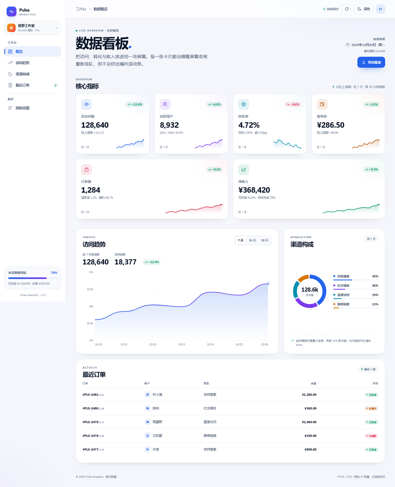
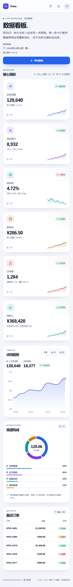
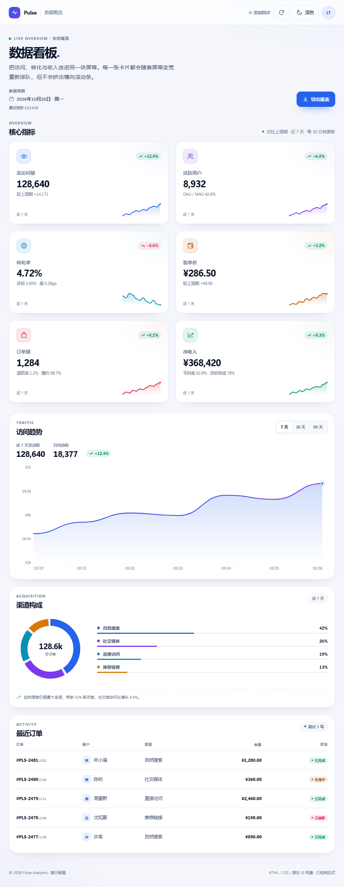

# Pulse Analytics · 响应式数据看板

用 **HTML + CSS + 原生 JavaScript** 手写的数据看板。单文件、零依赖、无构建步骤，在 320px–1920px 的宽度区间内都不会出现横向滚动条。

> 在线预览：待 GitHub Pages 部署后更新



## 预览

| 手机（390px） | 平板（900px） |
| --- | --- |
|  |  |

> 深色主题预览见 [`preview-dark.png`](preview-dark.png)。

## 作业要求对照

| # | 要求 | 实现方式 |
| --- | --- | --- |
| 1 | 三个断点：<768 单列、768–1199 两列、≥1200 四列 + 侧栏 | 三组明确的媒体查询；侧栏仅在 `min-width: 1200px` 时显示 |
| 2 | 卡片布局使用 grid 的 auto-fit / minmax() 或 flex-wrap，禁止写死 `width: 1200px` | `.kpi-grid` 使用 `repeat(auto-fit, minmax(...))`；平板/桌面断点用 `minmax(0, 1fr)` 显式列数；全站没有 `width: 1200px` |
| 3 | 320px–1920px 全区间不出现横向滚动条 | 宽度自适应 + `min-width: 0` + 表格列隐藏 + 图表按容器宽高重绘；已在 17 个宽度点实测 |
| 4 | 卡片的 6 条数据必须由 JS 数组渲染 | `metrics` 数组 + `renderMetrics()` 模板拼接，HTML 中没有重复的 6 段卡片 |
| 5 | 数字使用 `font-variant-numeric: tabular-nums`，切换时不抖动 | 全局与数值类均启用 `tabular-nums` + `"tnum"` |
| 6 | CSS 变量管理颜色，至少深/浅可切换 | 全部主题色集中在 `:root` / `[data-theme="dark"]`；右上角按钮切换并写入 `localStorage` |
| 7 | 图片/图标有明确尺寸，图标用内联 SVG + `currentColor` | 所有图标为内联 SVG，带 `width` / `height`，颜色继承 `currentColor`；Sparkline、环形图也标明尺寸 |
| 8 | 语义化：h1/h2、section、button | 一个 `h1`、四个 `h2`、`section[aria-labelledby]`、原生 `<button>` |

## 断点

| 视口宽度 | 卡片列数 | 侧栏 |
| --- | --- | --- |
| `< 768px` | 1 列 | 隐藏 |
| `768px – 1199px` | 2 列 | 隐藏 |
| `≥ 1200px` | 4 列 | 固定侧栏 |

> 桌面端后两张卡片各跨两列，填满 4 列网格的第二行。

## 可交互功能

- **深色 / 浅色主题**：按钮切换，记忆主题，跟随系统初始偏好。
- **访问趋势**：7 / 30 / 90 天切换，SVG 图表随容器宽度重绘；鼠标悬停查看每日访问量。
- **导出报表**：把 6 项指标导出为带 BOM 的 UTF-8 CSV。
- **刷新**：更新右上角“最后更新”时间并给出反馈。
- **响应式表格**：手机端自动隐藏客户和渠道列，只保留订单、金额、状态。

## 本地查看

直接双击 `index.html` 即可。若想用本地服务器：

```bash
npx serve .
# 或
python -m http.server 8000
```

## 技术说明

- 无框架、无外部字体、无图片请求；图标、图表、环形图全部内联 SVG。
- 图表使用容器实测宽高计算 `viewBox`，并使用 `ResizeObserver` 跟随尺寸变化。
- 数值数组、渠道数据、订单数据均由 JavaScript 渲染。
- 支持 `prefers-reduced-motion`，键盘焦点有可见样式。
